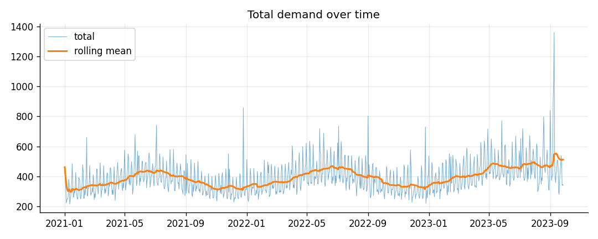
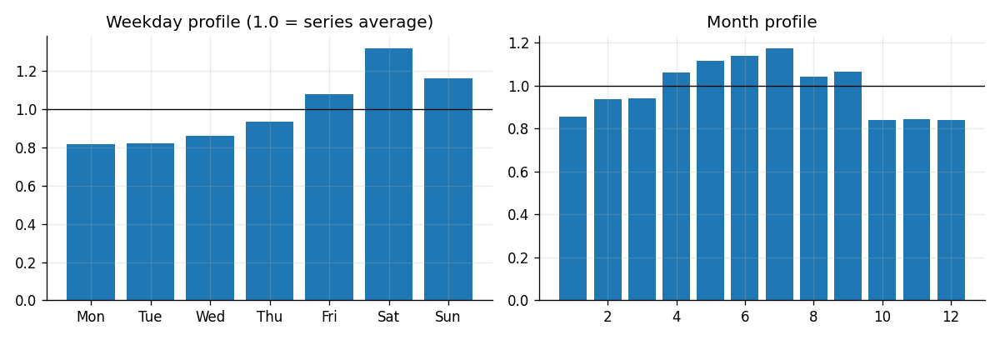
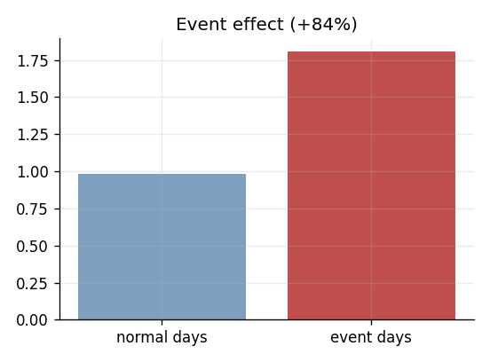
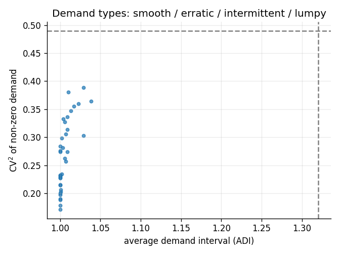
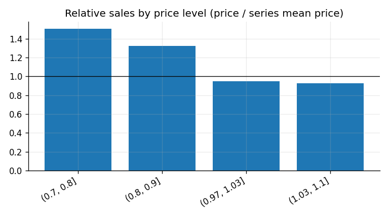
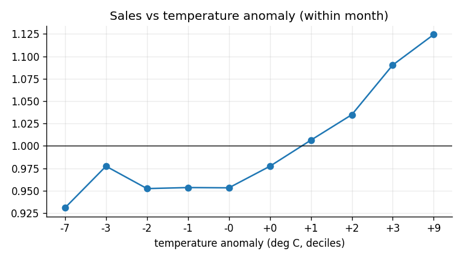
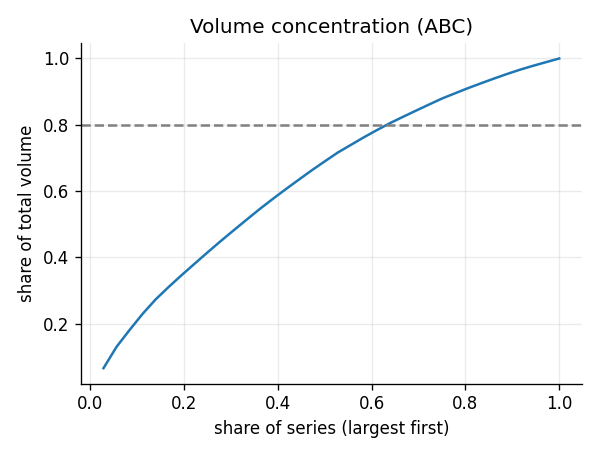
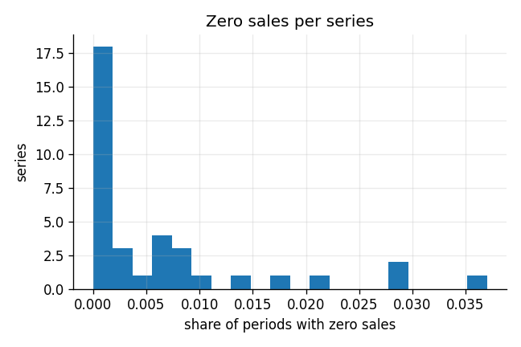
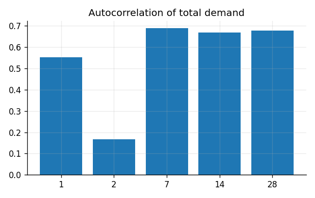

# Data audit and EDA - synthetic

_Generated by `demand-agents eda`. Numbers describe the data actually used; rerun after any change to the data._

## 1. Overview

- Period: **2021-01-01 to 2023-09-27** (1000 days)
- Series: **36** (3 stores x 12 items)
- Rows: **36,000**; zero-sales share **0.6%**; mean sales 10.96
- Demand types: {'smooth': 36}

## 2. Cleaning applied

| step | rows_affected | note |
|---|---|---|
| drop rows with missing date / series / sales | 0 |  |
| drop duplicate (series, date) rows | 0 | kept the last occurrence |
| negative sales set to 0 | 0 |  |
| non-integer sales rounded (count data) | 0 |  |
| price <= 0 set to missing | 0 |  |
| missing price carried forward within series | 0 | 0 leading values stay missing |
| temperature outside (-60.0, 55.0) set to missing | 0 |  |
| rows kept | 36000 | 100.00% of the 36,000 input rows |

Deliberately **not** removed: demand spikes and zero-sales days (they are the shocks under study).

## 3. Issues found

| severity | check | detail | action |
|---|---|---|---|
| info | demand spikes | 0.12% of observations are > 6 robust sigmas from their series median | KEPT: spikes are the shocks the Critic must detect; they are not errors |

## 4. Integration

- No external weather merged into this table.
- M5 and Walmart are **not** merged with each other (different stores, period, measure and frequency); each is modelled separately.

## 5. Exploratory findings

## 6. What this means for modelling

- **Strong weekly pattern** (weekday spread 50% of average). Keep lags that are multiples of 7 and a weekday feature.
- **Yearly seasonality is visible**: keep month / week-of-year features.
- **Events matter** (sales +84% on event days): keep the event flag; the Critic should treat events as known risk.
- **0% of series are intermittent or lumpy.** Most series are smooth or erratic, so standard forecasting applies.
- **Price moves demand** (median slope -1.47, negative for 100% of series): keep price features.
- **Weather matters for 42% of series**: keep weather features and the Critic's weather signal.
- **Volume is concentrated**: 22 of 36 series carry 78% of the volume; consider per-class service levels.
- Total demand is strongly autocorrelated at lag 7 (0.69): a 7-day-ahead forecast can lean on last week.
